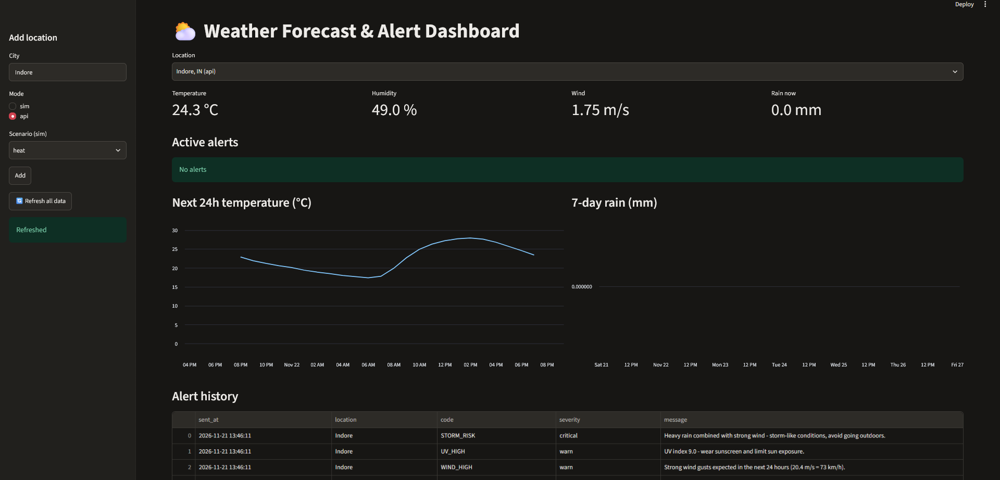
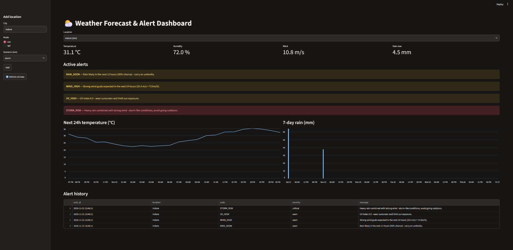
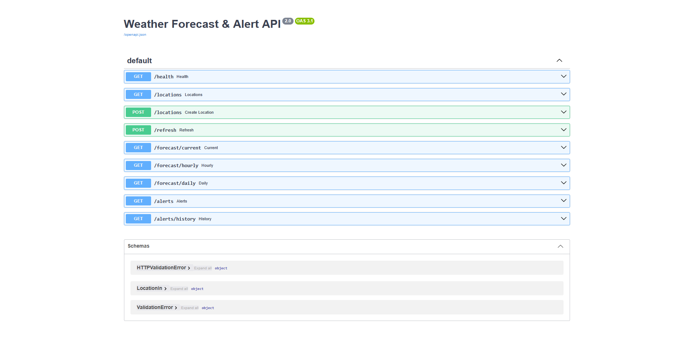
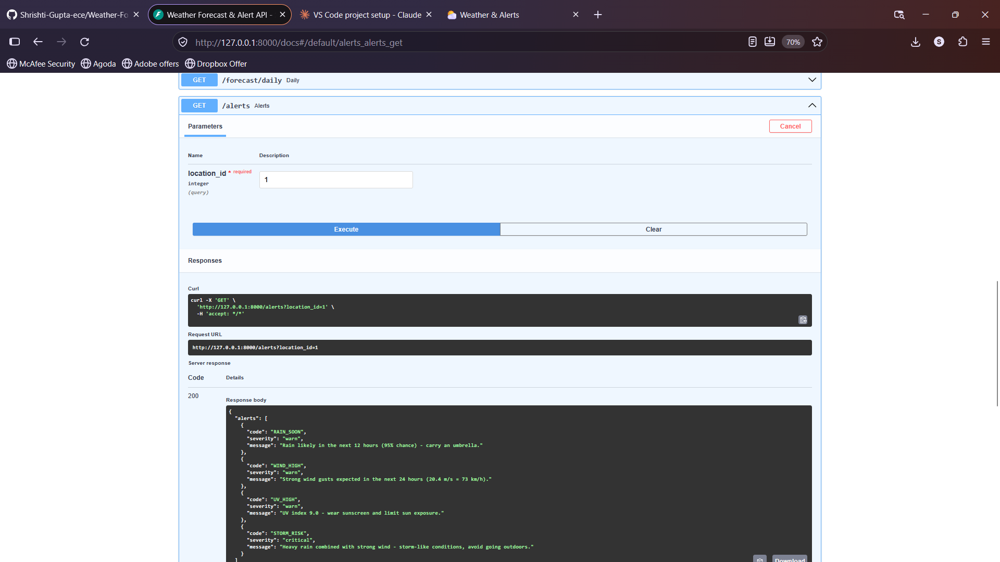
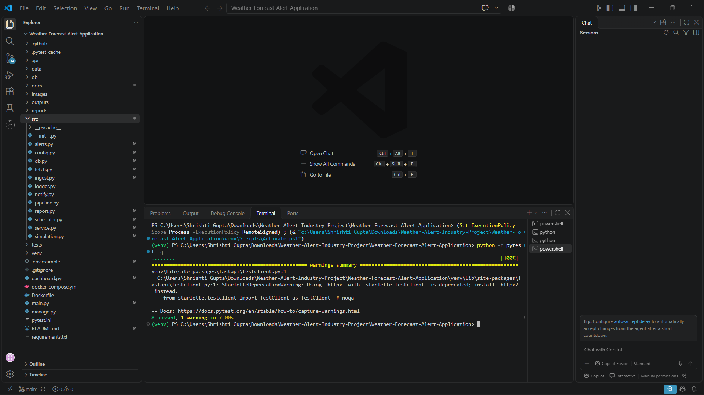

# ⛅ Weather Forecast & Alert Application (v2 — Industry Edition)

Provider-agnostic weather pipeline: **ingest → store → rule engine → REST API → scheduler → dashboard → notifications.**
Works with real data (Open-Meteo, no API key) or a virtual **simulation mode** (offline).

## Problem & Industry Relevance
Logistics, agriculture, energy, travel and public-safety teams need automated short-term alerts (rain / heat / wind / UV / storm) to plan work and reduce downtime.

## Architecture
```
Open-Meteo API / Simulation
        │  (retry + exponential backoff)
        ▼
   ingest.py ──► SQLite: weather_raw, weather_current, weather_hourly, weather_daily
                         │
                         ▼
                 service.py + alerts.py  (rule engine, thresholds in config.py)
                  │            │
                  ▼            ▼
            FastAPI (api/)   dispatch() ─► alert_log (12h de-duplication)
                  │                         └► Console / Telegram
                  ▼
        Streamlit dashboard        APScheduler (refresh 2h, alerts 30min)
```

## Features
- Multi-location tracking, normalized time-series (°C, mm, m/s)
- Raw payload stored for provenance; idempotent upserts; missing values handled as NULL
- Rules: RAIN_SOON, HEAT_WAVE, WIND_HIGH, HUMIDITY_HIGH, UV_HIGH, STORM_RISK
- Alert de-duplication (no spam), alert history table
- REST API (FastAPI, auto docs at `/docs`), Streamlit dashboard
- Retry/backoff, logging, pytest tests, Docker, GitHub Actions CI

## Setup
```bash
python -m venv venv
venv\Scripts\activate         # Windows   |  source venv/bin/activate  (Mac/Linux)
pip install -r requirements.txt
cp .env.example .env          # optional: Telegram keys
```

## Run
```bash
# 1) CLI
python manage.py add-location Indore --mode sim --scenario storm
python manage.py add-location Mumbai --mode api
python manage.py refresh
python manage.py alerts
python manage.py dispatch

# 2) API  -> http://127.0.0.1:8000/docs
uvicorn api.app:app --reload

# 3) Dashboard
streamlit run dashboard.py

# 4) Scheduler (auto refresh + alerts)
python -m src.scheduler

# 5) Tests
pytest -q

# 6) Docker
docker compose up --build
```
One-shot report mode (CSV + text report + chart): `python main.py --mode sim --city Indore --scenario storm`

## API Endpoints
`GET /health` · `GET/POST /locations` · `POST /refresh` · `GET /forecast/current|hourly|daily?location_id=` · `GET /alerts?location_id=` · `GET /alerts/history`

## Screenshots
## Screenshots

### Dashboard: real-time data (Open-Meteo)


### Dashboard: simulated storm scenario with alerts


### REST API (FastAPI docs)



### Tests


(images/01_folder_structure.png)

## Learning Outcomes
API integration, data modeling (SQL), rule engines, REST design, scheduling/automation, idempotency & de-duplication, testing (golden tests), Docker, CI/CD, secret management.


